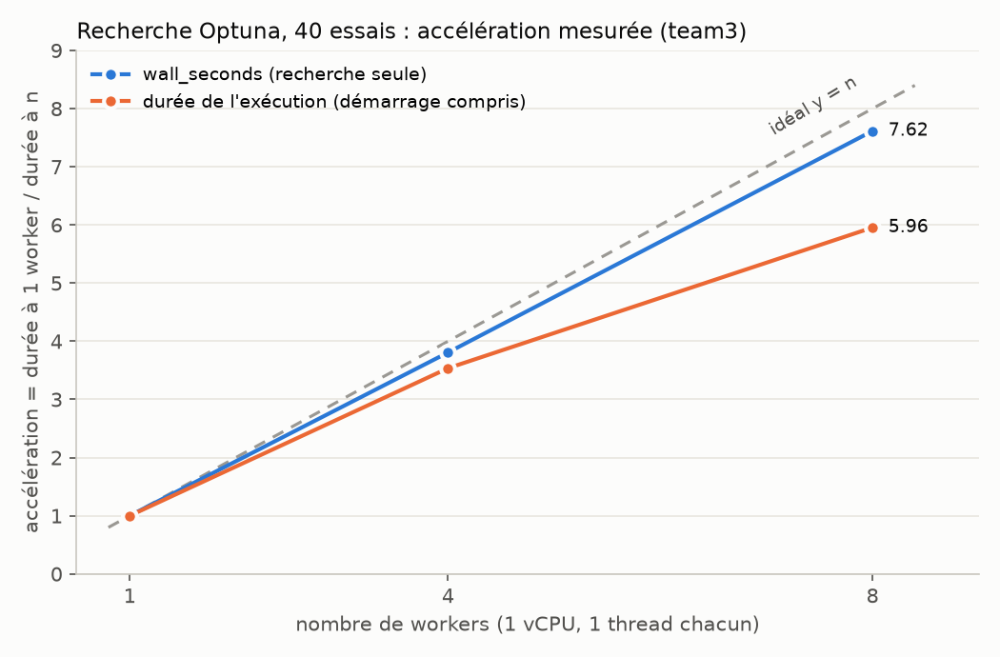

# Compte rendu séance 5 — team3

| Mesure | Valeur |
| --- | --- |
| Étape 0 : lignes relues dans `MANIFEST.json` (`train-sample`, `valid`, `test`) ; version et alias du modèle en place | 611 548 , 311 624 , 301 545 ; version 1 , alias `champion` (`fraud-scorer-team3`, ID `5677326090998120448`) |
| Étape 1 : `run_id`, commit, image, graine, AP de validation | `20261118T180926Ze4ef8a`, `8c2691192d9cb5604b54bb8e9e605fac78a077c0`, `fraud-train:td5`, 42, 0,8512 |
| Étape 1 : durée de l'exécution ; `load` et `fit` de `metadata.json` | 104 s ; 19,0 s, 26,8 s |
| Étape 3 : `run_id` du modèle 12 mois ; `fit` ; AP de validation | ... ; ... s ; ... |
| Étape 3 : AP test candidat et champion ; écart et IC à 95 % ; verdict | ... , ... ; ... [... ; ...] ; ... |
| Étape 3 : version au registre (ou « refus ») ; `rang_lecture_test` | ... ; ... |
| Étape 4 : débits DDP à 1 et 2 processus ; AP de validation | ... et ... échantillons/s ; ... et ... |
| Lien du dépôt (`infra/job.tf`) | <https://github.com/DeJongnick/ai-cloud-infra-terraform-student> |

## Entraînement comme un job (étape 1)

Deux exécutions identiques du job (`train.job`, 1 tâche, 1 vCPU, 2 Gio, 1 thread) :

| | Exécution 1 | Exécution 2 |
| --- | --- | --- |
| `run_id` | `20261118T180926Ze4ef8a` | `20261118T181218Zd8f978` |
| AP de validation | 0,8512 | 0,8512 |
| sha256 de `model.ubj` (début) | `e22a41dee310884b` | `e22a41dee310884b` |
| `load` / `fit` / `eval` | 19,0 s / 26,8 s / 3,0 s | 18,1 s / 24,8 s / 2,0 s |
| CPU vus par le conteneur (`cpu_count`) | 5 | 6 |

**1. Avec ce seul `metadata.json`, qu'est-ce qu'un tiers peut refaire exactement ?**
Le même entraînement : il connaît les fichiers lus, avec leur nombre de lignes et leur `sha256`, ce qui
lui permet de vérifier qu'il a les mêmes octets. Il connaît aussi la liste et l'ordre des variables,
le commit du code, l'image, la configuration complète (hyperparamètres, threads, période), la graine
et les versions de Python, XGBoost et numpy. Pour obtenir le même modèle au bit près, il lui manque
encore deux éléments :
- **L'empreinte de l'image.** Le tag `td5` peut être déplacé vers une autre image, alors que le
  `digest` (`sha256:...`) ne change jamais.
- **Une description complète de la machine.** Elle est ici partielle : 5 ou 6 CPU vus selon
  l'exécution. Avec plusieurs threads, l'ordre des additions de nombres décimaux peut changer, et
  donc le résultat au dernier bit.

**2. Relancée, l'exécution change-t-elle de `run_id` ? d'AP ?**
Le `run_id` change, parce qu'il est construit à partir de l'horodatage et d'un suffixe aléatoire : il
identifie une exécution, pas une recette. L'AP ne change pas (0,8512), et le modèle est identique octet
pour octet (même `sha256`). Mêmes données, même code, même image, même configuration et même graine 42,
avec un seul thread : l'entraînement est déterministe. Seules les durées varient.

**3. Où le test apparaît-il dans `metadata.json` ?**
Nulle part : seuls `train-sample` et `valid` sont listés dans `data`. C'est voulu. L'entraînement et le
choix des hyperparamètres ne doivent jamais voir le test. Le test est lu une seule fois, par `train.gate`,
pour décider : sinon la mesure finale serait optimiste.

## Recherche (étape 2)

| Étude | Workers | vCPU par tâche | Threads | Essais terminés | `wall_seconds` | Durée de l'exécution | `sum_fit_seconds` | Meilleure AP | Tâches réussies / lancées |
| --- | --- | --- | --- | --- | --- | --- | --- | --- | --- |
| leo-w1-t1 | 1 | 1 | 1 | 40 | 1 540 s | 1 584 s (26 min 24 s) | 1 381 s | 0,8561 | 1 / 1 |
| leo-w4-t1 | 4 | 1 | 1 | 43 | 404 s | 448 s (7 min 28 s) | 1 373 s | 0,8565 | 4 / 4 |
| leo-w8-t1 | 8 | 1 | 1 | 47 | 202 s | 266 s (4 min 26 s) | 1 329 s | 0,8544 | 8 / 8 |
| leo-w4-t4 | 4 | 4 | 4 | 43 | 160 s | 210 s (3 min 30 s) | 544 s | 0,8547 | 4 / 4 |

Les trois premières études ont été lancées en même temps (18 novembre 2026, 19:13, heure de Paris), chacune
sur ses propres instances ; la quatrième à 19:30. Aucune tâche en échec, pas de `Stale file handle`.
La durée de l'exécution va du démarrage de l'exécution (`startTime`) à sa fin (`completionTime`).

Répartition des essais entre les workers (`worker-<i>.json`) : 10, 12, 12 et 9 essais à 4 workers ;
5, 7, 6, 5, 6, 6, 6 et 6 à 8 workers (durées par worker de 189 à 216 s).

| Workers | Accélération sur `wall_seconds` | Accélération sur la durée de l'exécution | Idéal |
| --- | --- | --- | --- |
| 1 | 1,00 | 1,00 | 1 |
| 4 | 3,81 | 3,54 | 4 |
| 8 | 7,62 | 5,96 | 8 |

Accélération = durée à 1 worker / durée à n workers. Nous retenons la **durée de l'exécution** comme
mesure principale : c'est le temps qu'attend l'équipe, et c'est ce qui est facturé. `wall_seconds`
(du début du premier essai à la fin du dernier) isole la recherche elle-même, sans la part fixe ; la
comparaison des deux courbes montre ce que coûte cette part fixe.

### Coût de chaque recherche

Prix des jobs Cloud Run, région `europe-west1` (Belgique), tarif par défaut, relevés le 18 novembre 2026
sur <https://cloud.google.com/run/pricing> (section « Tâches ») : **0,000018 $ par vCPU-seconde** et
**0,000002 $ par Gio-seconde**.

Formule : coût = Σ sur les tâches de (durée de la tâche en s) × (vCPU × 0,000018 + Gio × 0,000002).

| Étude | Ressources par tâche | Prix par tâche-seconde | Somme des durées des tâches | Coût |
| --- | --- | --- | --- | --- |
| leo-w1-t1 | 1 vCPU, 2 Gio | 0,000022 $ | 1 575 s | 0,035 $ |
| leo-w4-t1 | 1 vCPU, 2 Gio | 0,000022 $ | 1 647 s | 0,036 $ |
| leo-w8-t1 | 1 vCPU, 2 Gio | 0,000022 $ | 1 688 s | 0,037 $ |
| leo-w4-t4 | 4 vCPU, 8 Gio | 0,000088 $ | 760 s | 0,067 $ |

Hypothèses :
- On compte toute la durée de chaque tâche, démarrage, lecture des données et écriture des
  résultats compris. C'est ce que Cloud Run facture.
- On ne déduit pas le quota gratuit mensuel (240 000 vCPU-secondes et 450 000 Gio-secondes),
  partagé par tout le projet.
- On ne compte pas la base PostgreSQL d'Optuna, fournie et partagée par le socle, ni le stockage des
  résultats (quelques Ko), ni les journaux.
- Prix en dollars, sans remise d'engagement.

### Questions de l'étape 2

**1. Pourquoi le gain n'est-il pas proportionnel au nombre de workers ?**
Le travail total ne diminue pas, il est réparti : `sum_fit_seconds` reste autour de 1 330 à 1 380 s
quel que soit le nombre de workers. Quatre causes, que nos chiffres permettent de mesurer, éloignent
l'accélération de la droite idéale :
- **La part fixe de chaque exécution.** L'écart entre la durée de l'exécution et `wall_seconds` est
  de 44 s à 1 worker, 43 s à 4 workers et 64 s à 8 workers. Il comprend la planification, le démarrage
  des conteneurs et la lecture des données à travers le montage. À 8 workers, les tâches n'ont démarré
  que 34 s après le début de l'exécution. Cette part ne se divise pas : elle pèse 3 % de l'exécution à
  1 worker, mais 24 % à 8 workers. C'est pour cela que l'accélération tombe à 5,96 sur la durée de
  l'exécution, contre 7,62 sur `wall_seconds`.
- **Les essais en plus.** 43 essais à 4 workers et 47 à 8 workers, au lieu de 40 : 7,5 % et 17,5 % de
  travail en plus.
- **Le déséquilibre entre les workers.** L'exécution se termine avec le dernier worker. À 8 workers,
  les workers font de 5 à 7 essais, avec des durées de 189 à 216 s, et les essais n'ont pas tous la
  même durée (de 100 à 400 arbres, profondeur de 3 à 10). Avec environ 5 essais par worker, un seul
  essai long suffit à retarder la fin.
- **La coordination.** Chaque essai lit et écrit dans la base PostgreSQL partagée.

**2. Combien d'essais a-t-on terminés à 4 et 8 workers ? D'où viennent les essais en plus ?**
43 à 4 workers et 47 à 8 workers. Chaque worker vérifie, avant de commencer un essai, que l'étude
compte moins de 40 essais terminés. Quand le 40ᵉ se termine, les autres workers ont chacun un essai en
cours et le terminent. Au plus, il y a donc workers − 1 essais en plus : 3 à 4 workers, 7 à 8 workers.
Nous atteignons exactement ce maximum dans les deux cas.

**3. La quatrième configuration (4 workers, 4 vCPU et 4 threads par tâche)**
- **Durée d'un essai.** Elle passe de 31,9 s à 12,7 s en moyenne (`sum_fit_seconds` / essais), soit
  2,5 fois plus vite pour 4 fois plus de vCPU. Les threads de XGBoost ne parallélisent qu'une partie
  du calcul : le reste ne gagne rien.
- **Durée totale.** Elle passe de 448 s à 210 s : c'est la configuration la plus rapide, plus que
  8 workers à 1 vCPU (266 s).
- **Coût.** Il passe de 0,036 $ à 0,067 $, presque le double : on paie 4 fois plus de vCPU et de
  mémoire par seconde pour une tâche 2,2 fois plus courte.

Si threads × workers dépasse les vCPU payés, les threads se partagent un quota qui ne grandit pas. Le
conteneur voit 5 ou 6 CPU (`cpu_count`) alors qu'on n'en paie qu'un, mais Cloud Run limite le temps
CPU au quota. Les threads en trop attendent leur tour et se gênent (changements de contexte, caches),
si bien que l'essai n'est pas plus rapide, et souvent plus lent. Le nombre de CPU vus ne dit pas
combien on en a : il faut mesurer.

**4. À coût égal, plus de workers ou plus de vCPU par worker ?**
Pour ce problème, plus de workers. Les essais sont indépendants et courts, avec environ 30 s
d'entraînement chacun. Le passage à 4 ou 8 workers coûte presque le même prix (0,035 $ à 0,037 $) pour
une accélération de 3,5 à 6, alors que 4 vCPU par worker double le coût pour un essai 2,5 fois plus
rapide seulement.

Pour un modèle dix fois plus long à entraîner, la part fixe devient négligeable et l'accélération par
workers se rapproche encore de l'idéal. Les workers restent donc le meilleur choix tant qu'il y a
beaucoup d'essais. Les vCPU par worker deviennent intéressants dans trois cas :
- quand chaque essai doit finir vite ;
- quand il y a peu d'essais à répartir ;
- quand les données sont trop lourdes pour être chargées par de nombreux workers.

Il faut aussi tenir compte d'une limite de la recherche elle-même. Avec beaucoup de workers en
parallèle, chacun choisit ses hyperparamètres sans connaître les résultats des essais en cours. La
recherche bayésienne d'Optuna apprend alors moins vite à chaque essai.

**5. La meilleure AP diffère d'une étude à l'autre. Est-ce dû au parallélisme ?**
Les écarts sont faibles : de 0,8544 à 0,8565, soit 0,002. Chaque étude tire des hyperparamètres
différents, et avec 40 essais la meilleure AP dépend de la chance du tirage. Le parallélisme peut
jouer un peu, puisqu'un worker choisit sans connaître les résultats en cours. Mais une seule étude par
configuration ne permet pas de séparer cet effet du hasard. Pour le savoir, il faudrait :
- répéter chaque configuration plusieurs fois, avec des graines différentes pour l'échantillonneur ;
- comparer l'écart entre configurations à la dispersion à l'intérieur d'une même configuration.

## Entraînement final sur Vertex AI (étape 3, 12 mois)

| Threads | `rows.train` | `load` | `fit` | AP de validation |
| --- | --- | --- | --- | --- |
| 8 | ... | ... s | ... s | ... |

## Six questions

1. Quelles données, quel code et quelle configuration ont produit notre modèle ?
2. Combien de temps prend la recherche avec un, quatre et huit workers ?
3. Pourquoi le gain n'est-il pas proportionnel au nombre de workers ?
4. Combien a coûté notre recherche, et avec quelles hypothèses ?
5. Le modèle entre-t-il au registre, et sur quelle base ?
6. Démonstration DDP : qu'apporte le second processus, et pourquoi ? Une réponse par étudiant, signée
   de son prénom.
