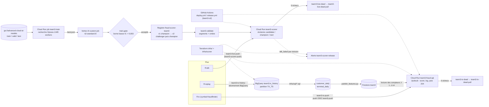

# Soutenance team3 — plan

Format : 20 min de présentation, 15 min de questions. Le prof veut voir le système, pas des slides :
**un seul schéma** (section 2), puis la console GCP et le dépôt en direct.

Ordre de la démo : on suit une transaction de bout en bout, du flux au modèle en service. Chacun
défend son choix au moment où la démo passe sur sa partie.

## 1. Déroulé minuté

| Temps | Qui | Ce qu'on dit | Ce qu'on montre |
| --- | --- | --- | --- |
| 0:00 – 2:00 | Léo | Le cas : scorer chaque transaction FraudFinder en ligne, sous SLA. La chaîne en une phrase par bloc. | Le schéma (section 2), seule « diapo ». |
| 2:00 – 6:00 | Léo | **Choix 1 (Léo)** : lire les compteurs dans Firestore au moment du scoring (TD4 C). TD1 en 30 s, comme origine du raisonnement « mesurer avant d'optimiser ». | Cloud Run `team3-fraud-api` → Révisions (image `ref-fraud-api:td4`, `FEATURE_SOURCE=firestore`) ; BigQuery `team3.tx_history` (partition `TX_TS`), `customer_daily` ; Firestore base `team3` ; `curl` 403 sans jeton / 200 avec. |
| 6:00 – 10:00 | Pierre | **Choix 2 (Pierre)** : push Pub/Sub authentifié vers le service, acquittement après le travail, file de messages morts à 5 tentatives (TD3). | Pub/Sub → `team3-tx-push` (endpoint `/pubsub`, OIDC `team3-push`, lettre morte 5) ; IAM du service (seul `run.invoker`) ; Logs Explorer `delivery_attempt` ; tableau de montée en charge du compte rendu TD3. |
| 10:00 – 13:30 | Nicolas | **Choix 3 (Nicolas)** : paralléliser la recherche par workers plutôt que par vCPU (TD5). Règle d'entrée appliquée une fois. | Cloud Run Jobs `team3-train` (exécutions) ; `docs/seance-5/acceleration.png` ; Vertex AI → Registre `fraud-scorer-team3`, versions 1 et 2 ; GCS `runs/team3/decisions/`. |
| 13:30 – 17:30 | Richard | **Choix 4 (Richard)** : valider le challenger sur les segments et en ombre, pas sur la moyenne, avant tout trafic (TD6 étape 2). Puis paliers et panne `next` en 1 min. | `docs/seance-6/validation.txt` (segments) ; Cloud Run `team3-scorer` → Révisions et trafic (tags `candidate`, `champion`) ; tableau de bord « TD6 team3 » sur le 20/11 13:20-13:45 ; log `Feature shape mismatch`. |
| 17:30 – 19:00 | Pierre ou Léo | Ce que l'incident a changé : l'alerte en code et le test de fumée bloquant. | Monitoring → Alertes `team3-scorer-release` ; `infra/release.tf` ; GitHub Actions : run `release` en échec sur le test de fumée, puis en succès. |
| 19:00 – 20:00 | Léo | Limites assumées (section 6) en 3 phrases, et ce qu'on ferait ensuite. | — |

Transitions (une phrase chacune) :
- Léo → Pierre : « Le service sait scorer ; reste à lui amener les transactions sans en perdre. »
- Pierre → Nicolas : « Le flux est stocké ; on s'en sert pour réentraîner le modèle. »
- Nicolas → Richard : « Le challenger entre au registre ; il faut maintenant le mettre en service sans risque. »
- Richard → fin : « La panne nous a appris ce qui manquait : on l'a écrit en code. »

## 2. Schéma de la chaîne



Version courte à dire : flux Pub/Sub → service privé sur Cloud Run → historique BigQuery → compteurs
recopiés dans Firestore et relus au scoring → réentraînement en job → règle d'entrée → registre →
validation, ombre, paliers → alerte. Terraform décrit l'infrastructure, la CI choisit la version.

## 3. Le choix de chacun

### Léo — Firestore pour lire les features en direct (TD4 C)

- **Choix** : Firestore, recopié chaque jour depuis BigQuery.
- **Alternatives rejetées** : parquet en mémoire (rapide mais figé) ; BigQuery à chaque transaction.
- **Contrainte qui tranche** : le débit du flux. BigQuery à 370 ms p50 limite une instance (concurrence 4)
  à ≈ 11 tx/s, soit ≈ 32 tx/s pour 3 instances, contre ≈ 530 msg/s tenus en séance 3.
- **Preuve** : `docs/seance-4/compte-rendu.md`, partie C : même protocole pour les trois sources
  (3 appels d'échauffement, 200 `POST /predict` sur les mêmes transactions du 2 octobre, `timings_ms.features`).
  parquet 0,68 / 1,87 ms ; firestore 13,9 / 38,3 ms ; bigquery 370 / 758 ms (p50 / p99). Le score de
  `275114ca…` est le même avec firestore et bigquery (0,000193), différent avec parquet (0,000102) : le
  parquet ne connaît pas la veille.
- **Limites** : mesure par `/predict` et non sous charge réelle ; coût Firestore par lecture non chiffré ;
  la copie quotidienne n'est pas planifiée (lancée à la main). Pour lever : rejouer le flux à 500 msg/s
  avec `FEATURE_SOURCE=firestore` et lire `features_ms` p99 ; chiffrer lectures/jour × prix ; Cloud Scheduler.
- **En direct** : révision active de `team3-fraud-api` (variable `FEATURE_SOURCE`), base Firestore `team3`,
  `curl` 200 qui renvoie `"source":"firestore"`.
- Choix de secours si le prof veut un autre TD : la partie D (HNSW, `m = 16`, `ef = 4`, rappel 0,990,
  p50 0,51 ms), notée individuellement.

### Pierre — push authentifié, acquittement après le travail, lettre morte (TD3)

- **Choix** : abonnement push vers `/pubsub`, jeton OIDC signé par un compte dédié `team3-push`
  (seul droit : `run.invoker` sur le service), 204 renvoyé après le log, lettre morte à 5 tentatives.
- **Alternatives rejetées** : abonnement pull (il faut un consommateur qui tourne en permanence) ;
  réutiliser `team3-run` pour la livraison (trop de droits) ; acquitter avant de scorer (message perdu si
  le service tombe).
- **Contrainte qui tranche** : ne perdre aucune transaction avec un service privé, au moindre privilège.
- **Preuve** : `docs/seance-3/compte-rendu.md`. Montée en charge du 16/11 : suivi sans retard jusqu'à
  ≈ 530 msg/s ; au-delà, 3 instances au maximum, file jusqu'à 81 038 messages, âge maximal 138 s, 14 550
  refus 429 relivrés, file vidée en 2 min, aucun message perdu. Message empoisonné `poison-20261116` en
  lettre morte après 5 livraisons (1 min 35 s).
- **Limites** : plafond fixé par `max_instance_count = 3` et la concurrence 4 ; doublons possibles
  (livraison « au moins une fois », 15 591 lignes avec `delivery_attempt` > 1) ; pas d'idempotence
  garantie si `/pubsub` écrivait un jour dans les compteurs. Pour lever : refaire le palier à 700 msg/s
  avec `max_instance_count` relevé ; dédupliquer par `message_id`.
- **En direct** : Pub/Sub → `team3-tx-push` (endpoint, OIDC, lettre morte) ; IAM de `team3-fraud-api` ;
  Logs Explorer filtré sur `delivery_attempt>1`.

### Nicolas — plus de workers plutôt que plus de vCPU par worker (TD5)

- **Choix** : paralléliser la recherche d'hyperparamètres par tâches Cloud Run à 1 vCPU.
- **Alternative rejetée** : 4 vCPU et 4 threads par worker.
- **Contrainte qui tranche** : le coût à durée comparable. Essais indépendants et courts (≈ 30 s).
- **Preuve** : `docs/seance-5/compte-rendu.md`, étape 2. Même étude (40 essais, même espace) : 1 worker
  1 584 s, 4 workers 448 s, 8 workers 266 s (accélération 3,54 et 5,96) pour 0,035 $, 0,036 $, 0,037 $.
  4 workers × 4 vCPU : 210 s mais 0,067 $ (essai 2,5 fois plus rapide pour 4 fois plus de vCPU).
- **Écart au linéaire** : part fixe 43 à 64 s (24 % de l'exécution à 8 workers), essais en plus (43, 47),
  déséquilibre entre workers, coordination par la base Optuna.
- **Limites** : une seule étude par configuration (la meilleure AP varie de 0,002, non séparable du
  hasard) ; quota gratuit et base PostgreSQL non comptés. Pour lever : répéter chaque configuration avec
  plusieurs graines d'échantillonneur.
- **En direct** : Cloud Run Jobs `team3-train`, onglet Exécutions (nombre de tâches, durée) ; la courbe
  `acceleration.png` ; registre `fraud-scorer-team3`.
- Il doit aussi pouvoir dire la règle d'entrée : borne basse de l'IC de l'écart d'AP (0,0116) > marge
  0,003, test lu une seule fois (`rang_lecture_test` = 1).

### Richard — valider sur les segments et en ombre avant tout trafic (TD6)

- **Choix** : décider sur les segments et sur l'ombre, pas sur l'AP moyenne.
- **Alternatives rejetées** : décider sur l'AP globale seule ; passer directement à 10 % sans ombre.
- **Contrainte qui tranche** : une moyenne peut cacher un segment dégradé ; l'ombre mesure le candidat sur
  le vrai flux sans appliquer ses décisions.
- **Preuve** : `docs/seance-6/validation.txt` et `mesures.md`, étape 2. AP 0,8679 contre 0,8473, écart
  +0,0206, IC [0,0158 ; 0,0251] ; segment le plus faible « montant ≥ 75 » : +0,0082 [0,0034 ; 0,0132], tous
  les segments concluants. Ombre : 4 773 transactions communes, désaccord 4,34 %, écart d'alertes
  −1,83 point, p95 2,32 ms contre 2,58 ms.
- **Limites** : le mois de validation a servi à choisir les hyperparamètres (écarts optimistes) ; la
  borne d'alertes a été fixée après l'ombre ; l'ombre ne mesure pas l'effet métier des décisions.
- **En direct** : `team3-scorer` → Révisions et trafic ; tableau de bord « TD6 team3 » ; job `team3-validate`.

### Point commun à présenter (Pierre, 20/11) : paliers, panne, retour

- Paliers 10 / 50 / 100 % : 0 % d'erreur, p95 2,6 ms au plus, critère cité à chaque décision.
- Panne `next` à 10 % : 100 % d'erreurs, détectée en 2 min 48 s, cause `Feature shape mismatch, expected: 22, got 20`,
  `/health` à 200 quand même. Retour vers `candidate`, mesuré 3 min après : 0 % d'erreur, p95 2,1 ms.
- Actions : alerte `team3-scorer-release` (> 10 échecs/min/révision pendant 60 s, gain estimé ≈ 1 min 30)
  et test de fumée bloquant dans `release.yml`.

## 4. Liens et commandes de démo

Projet `advanced-cloud-ai`, région `europe-west1`. Vérifiés en lecture le 23/11.

| Quoi | Lien ou commande |
| --- | --- |
| Cloud Run, services | https://console.cloud.google.com/run?project=advanced-cloud-ai |
| `team3-fraud-api`, révisions | https://console.cloud.google.com/run/detail/europe-west1/team3-fraud-api/revisions?project=advanced-cloud-ai |
| `team3-fraud-api`, métriques | https://console.cloud.google.com/run/detail/europe-west1/team3-fraud-api/metrics?project=advanced-cloud-ai |
| `team3-scorer`, révisions et trafic | https://console.cloud.google.com/run/detail/europe-west1/team3-scorer/revisions?project=advanced-cloud-ai |
| Jobs `team3-train`, `team3-validate` | https://console.cloud.google.com/run/jobs?project=advanced-cloud-ai |
| Pub/Sub, abonnements | https://console.cloud.google.com/cloudpubsub/subscription/list?project=advanced-cloud-ai |
| `team3-tx-push` | https://console.cloud.google.com/cloudpubsub/subscription/detail/team3-tx-push?project=advanced-cloud-ai |
| BigQuery, dataset `team3` | https://console.cloud.google.com/bigquery?project=advanced-cloud-ai&ws=!1m4!1m3!3m2!1sadvanced-cloud-ai!2steam3 |
| Firestore, base `team3` | https://console.cloud.google.com/firestore/databases/team3/data?project=advanced-cloud-ai |
| Registre Vertex AI | https://console.cloud.google.com/vertex-ai/models/locations/europe-west1/models/5677326090998120448?project=advanced-cloud-ai |
| Alerte `team3-scorer-release` | https://console.cloud.google.com/monitoring/alerting/policies/13752530996358291967?project=advanced-cloud-ai |
| Tableau de bord « TD6 team3 » | https://console.cloud.google.com/monitoring/dashboards/builder/f9c7ae47-5c46-4cbb-bfa0-46fd30787c1d?project=advanced-cloud-ai |
| Logs Explorer | https://console.cloud.google.com/logs/query?project=advanced-cloud-ai |
| Dépôt Terraform | https://github.com/DeJongnick/ai-cloud-infra-terraform-student |
| Dépôt applicatif et runs CI | https://github.com/DeJongnick/td2-fraud-api-albertschool/actions |
| TD1 (individuel, Léo) | https://github.com/lbouchand-eng/td1-scoring-albertschool |

Runs GitHub Actions (branche `ci-livraison`) :
- `release`, **échec volontaire sur le test de fumée** (modèle `next` : `/health` 200, `/predict` 500) :
  https://github.com/DeJongnick/td2-fraud-api-albertschool/actions/runs/45189954111
- `release`, succès : https://github.com/DeJongnick/td2-fraud-api-albertschool/actions/runs/45190412288
- `deploy`, échec sans rapport avec le test (tag de révision `cd` refusé, moins de 3 caractères) :
  https://github.com/DeJongnick/td2-fraud-api-albertschool/actions/runs/45190861041
- `deploy`, succès : https://github.com/DeJongnick/td2-fraud-api-albertschool/actions/runs/45191209073

Filtres Logs Explorer à coller :

```text
resource.type="cloud_run_revision" resource.labels.service_name="team3-fraud-api" jsonPayload.message="scored" jsonPayload.delivery_attempt>1
resource.type="cloud_run_revision" resource.labels.service_name="team3-scorer" jsonPayload.message="failed"
resource.type="cloud_run_revision" resource.labels.service_name="team3-scorer" jsonPayload.error:"Feature shape mismatch"
```

(Rétention des logs : 30 jours par défaut ; ceux du 16 et du 20/11 sont encore là le jour de la soutenance.)

Commandes :

```bash
URL=https://team3-fraud-api-ueiaychpgq-ew.a.run.app
curl -s -o /dev/null -w "%{http_code}\n" $URL/health                       # 403
curl -s -H "Authorization: Bearer $(gcloud auth print-identity-token)" $URL/health   # 200, source firestore
gcloud run services describe team3-scorer --region europe-west1 --flatten 'status.traffic[]' \
  --format 'table(status.traffic.revisionName,status.traffic.tag,status.traffic.percent)'
gcloud ai models list-version 5677326090998120448 --region europe-west1      # v2 : champion, challenger
terraform -chdir=infra plan                                                  # No changes
terraform -chdir=infra/scorer plan                                           # 1 to import, 0 to change
```

Ce qui n'existe plus, et quoi montrer à la place :

| Ressource | État | À montrer |
| --- | --- | --- |
| Révisions TD2 `00001-htb` à `00003-sct` | détruites en fin de séance 2 | tableau du rapport TD2, section « Preuves » |
| Base vectorielle `team3-vectors` (TD4 D) | arrêtée | tableaux rappel@10 / latence du compte rendu TD4 |
| Abonnement d'ombre `team3-shadow` | supprimé (créé puis retiré par Terraform) | `apres-td.md`, sortie des `apply` |
| Tag `next` | retiré | révision `team3-scorer-next-1120132555` sans trafic, et ses logs `failed` |
| Flux `ff-td6` | arrêté par l'enseignant | tableau de bord sur la plage du 20/11 13:20-13:45 |

## 5. Questions probables (critère 4)

**TD1 (Léo, individuel)**
- *Qu'est-ce qui limitait le service ?* `enrich` relisait les 500 000 lignes d'historique à chacun des
  55 appels de `query` par transaction : 13,88 ms sur 14,95 ms de temps serveur (93 %), contre 0,12 ms
  pour le modèle. Il passe de 1,40 à 10,38 ms par transaction quand H passe de 50 000 à 500 000.
- *Et la correction ?* Un index `groupby("client_id").indices` calculé une fois : `enrich` passe de
  10,38 à 1,27 ms (× 8,2), scores identiques (`check_golden`, écart 0).
- *Pourquoi `limit` aide après le pic ?* Sans limite, le serveur traite des demandes que le client a
  déjà abandonnées (plus de 2 s) : les échecs durent 5 s après le pic. Avec `limit = 8`, il répond 503
  tout de suite et revient à 20 ms dès la fin du pic, mais il reste à 89,4 % de réussite : `limit` ne
  crée pas de capacité.
- *Comment dimensionner le pic × 3 ?* Un réplica corrigé à 1 CPU tient 250 demandes/s (générateur de
  secours, celui du notebook plafonnait avant). Avec 30 % de marge, 175 demandes/s utiles, donc
  2 réplicas pour 300 demandes/s, environ 0,14 $ de l'heure sur Cloud Run, contre environ 5 réplicas
  de 2 CPU pour le code livré.
- *Limite principale ?* Mesuré sur un portable, sans réseau : le réseau réel ajoute environ 50 ms
  (TD2), et le pic au ras de la capacité donne 28 à 84 % de réussite selon l'exécution.

**TD2**
- *Pourquoi un compte `team3-run` plutôt que le compte par défaut ?* Moindre privilège : deux droits
  (lecture du bucket, écriture des logs) en séance 2, trois de plus en séance 4 pour BigQuery et Firestore.
- *Pourquoi le p99 vaut 17 fois le p50 ?* Sur 50 requêtes, le p99 est la première requête sur une instance
  froide ; démarrage ≈ 11 s.
- *Que fait `terraform plan` après un déploiement par CI ?* Il veut revenir sur l'image ; d'où le bloc
  `lifecycle { ignore_changes }` (voir `docs/ci-livraison.md`).

**TD3**
- *Doublons de `tx_id` ?* Oui, 15 591 lignes avec `delivery_attempt` > 1 : nouvelle livraison (même
  `messageId`), pas une seconde publication. Le scoring est idempotent, donc sans effet sur le résultat.
- *Qu'est-ce qui absorbe le retard ?* Le maximum de 3 instances × concurrence 4 = 12 requêtes en cours ;
  le surplus reste dans l'abonnement (429 relivrés).

**TD4**
- *Le filtre de partition a lu plus d'octets (7,0 Mo contre 6,2 Mo) : pourquoi ?* Toute la table est dans
  une seule partition (1er octobre) ; le filtre lit la colonne `TX_TS` en plus et n'écarte rien.
- *Où est empêchée la fuite temporelle ?* À la lecture : le service ne somme que J−1 à J−14 ;
  `check.sql` renvoie 0 et 0.
- *Pourquoi partitionner sur `TX_TS` et pas `publish_time` ?* Les transactions du 1er octobre ont été
  publiées le 16 novembre ; on filtre sur la date de transaction.

**TD5**
- *Pourquoi une marge de 0,003 ?* Deux graines donnent des AP différentes ; sans marge, on remplacerait
  le modèle par un équivalent favorisé par le hasard.
- *Pourquoi ne pas décider sur la validation ?* Elle a servi à choisir parmi plus de 160 essais :
  0,8679 en validation contre 0,8587 sur le test.
- *Que réplique DDP ?* Le modèle, ses gradients et l'état de l'optimiseur sur chaque processus ;
  FSDP/ZeRO découpent ces états quand le modèle ne tient plus en mémoire (réponse signée de Léo).

**TD6**
- *Pourquoi `/health` n'a rien vu ?* Il ne score pas : il ne vérifie pas le contrat de 22 contre 20 features.
- *Quel signal a détecté la panne ?* Le taux d'erreur (100 % > 5 %) ; l'âge des messages est resté à 26 s,
  p95 et taux d'alerte n'étaient pas calculables.
- *Différence tag / alias ?* Le tag route le trafic Cloud Run ; l'alias du registre désigne la version
  du modèle. Déplacer l'un ne change pas l'autre.
- *Réentraîner après la dérive ?* Non : montants et activité stables (< 0,2 %), seul le taux de fraude
  monte (+37 %), sur des labels encore incomplets. Politique : réentraîner sur résultats (AP sur J−14 à
  J−7 sous 0,8492).

## 6. Points faibles à assumer

| Point | Phrase à dire |
| --- | --- |
| Critères TD6 figés le 20/11 à 12 h 38, après la création des révisions candidates du 19/11 (19 h 45) | « Le 19/11, nous avons déployé avant d'écrire nos critères. C'est noté dans `mesures.md`. Le 20/11, les critères ont été écrits avant l'ombre et les paliers, mais pas avant cette première révision. » |
| TD1 fait tardivement | « Le TD1 était individuel ; je l'ai refait de bout en bout, mesures comprises, dans mon fork. » |
| Entraînement final sur 3 mois et 4 threads au lieu de 12 mois et 8 threads | « Sur consigne de l'enseignant, pour tenir le temps de séance. La règle d'entrée a été appliquée une fois sur ce modèle. » |
| Ombre de « Après le TD » non vérifiée de bout en bout | « L'abonnement a été créé puis supprimé par Terraform, mais le flux `ff-td6` était arrêté : aucun message n'est arrivé. » |
| Chiffres DDP (étape 4 du TD5) absents | « Nous n'avons pas noté les débits de la démonstration ; la question 6 est répondue sur le principe. » |
| Mode dégradé non fait | « Ligne Degradable à non : nous écrivons ce qui manque pour décider entre `allow` et `block`. » |
| Gain de l'alerte estimé, pas mesuré | « Estimé à partir des échecs par minute ; le délai d'ingestion des métriques de logs n'est pas mesuré. » |

## 7. Checklist de la veille

- Ne rien détruire : `team3-fraud-api`, `team3-scorer` (socle), `team3-tx-push`, `team3-tx-history`,
  dataset `team3`, Firestore `team3`, jobs `team3-train` et `team3-validate`, registre, alerte.
- `gcloud auth login` et `gcloud auth application-default login` le matin même ; tester les deux `curl`.
- `terraform -chdir=infra plan` → « No changes » (sinon, comprendre l'écart avant la soutenance).
- Onglets ouverts dans l'ordre de la démo (section 4), déjà connectés au compte de l'école.
- Logs Explorer : les trois filtres prêts, plage horaire réglée (16/11 18:00-18:15 ; 20/11 13:20-13:45).
- Tableau de bord « TD6 team3 » réglé sur le 20/11 13:20-13:45.
- Schéma affiché en plein écran ; `main` du fork Terraform à jour (rendu-final fusionnée).
- Chacun relit sa section 3 et deux questions d'un autre TD que le sien (section 5).
- Répétition chronométrée : chaque choix tient en 3 min 30 au plus.
